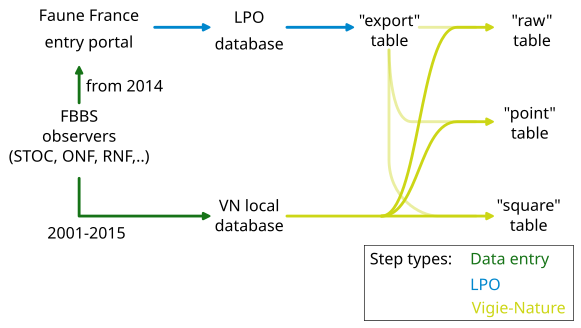

## STOC EPS {.unnumbered}

L'objectif est de suivre les populations d'oiseaux communs sur des carrés répartis aléatoirement. Dans chaque carré, sont notés tous les oiseaux vus ou entendus pendant 5 minutes sur 10 points d'écoute visités 1 à 3 fois par an.

### [Protocole](https://www.vigienature.fr/fr/suivi-des-oiseaux-communs-stoc) et saisie

Sur un *carré* de 2x2km tiré aléatoirement proche d'une commune donnée, les observateur.ice.s placent 10 *points* d'écoute dans des habitats représentatifs des habitats du carré. Un à trois *passages* sont effectués chaque année, le plus possible aux mêmes dates parmi trois périodes: mars, avril/début mai, mi-mai/mi-juin. A chaque passage, les observateur.ice.s parcourent les 10 points toujours dans le même ordre, entre 1h et 4h après le lever du soleil. A chaque point d'écoute, pendant 5 minutes, *tous* les oiseaux *contactés*, c'est à dire vus ou entendus, sont notés dans cinq *classes de distances* et l'*habitat* du point est noté selon une classification hiérarchique.

Depuis 2016, les données sont saisies sur Faune-France et versées dans une base de données LPO: les points sont géolocalisés sur Biolovision, leurs coordonnées sont fixes d'année en année.

::: {.callout-note collapse="true" title="Chronologie des types de saisie"}

Avant 2001, les carrés n'étaient pas tirés aléatoirement. Ces données historiques ne sont pas incluses dans les exports.

A partir de 2001, les données saisies étaient stockées à Vigie Nature. La saisie des coordonnées GPS des points n'était pas systématique, les coordonnées GPS fixes sont celles des carrés.

Période de tuilage entre 2014 et 2016 où les données étaient versées à VN et à la LPO, début de la saisie systématique des coordonnées des points.

Le passage de mars est optionnel depuis 2011 et fortement encouragé depuis 2022/2023.

Les données d'information météorologiques, saisies au début du protocole, ne sont plus demandées.
:::

### Structures de données

Trois niveaux d'export de données sont disponibles selon les analyses prévues, par niveau d'aggrégation de données décroissant:

 - données *"au carré"*: par année et par carré, une valeur d'abondance par espèce contactée
 - données *"au point"*: par année et par point, une valeur d'abondance par espèce contactée
 - données *"brutes"* : par année, par point et par passage, une valeur d'abondance par espèce contactée dans chaque classe de distance

Ces exports sont construits indépendamment, à partir de la base VN (données 2001-2015) et de la base LPO (données 2016 et plus).

L'export au carré est le plus utilisé et filtré. Il sert notamment au calcul des indicateurs PECBMS avec TRIM (fait par l'EBCC) ainsi qu'au calcul des indicateurs STOC avec la [routine de calcul](https://github.com/Vigie-Nature/indicatorRoutine) à VN.

::: {.panel-tabset}

#### Données "au carré"

| Nom du champ | Description | Format attendu^1^ |
|------------------|------------------------------------| ---------- |
|`site` | Identifiant unique du carré | string, six chiffres |
|`species` | Code CRBPO de l'espèce | string, six lettres majuscules |
|`num_dep` | Département du carré | string, deux chiffres |
|`abondance` | **abondance** de l'(espèce, carré, année)| nombre |
|`year` | Année | nombre entre 2001 et 2025 inclus |
|`longitude` | Longitude (WGS84) du carré | nombre à virgule (format US) |
|`latitude`	| Latitude (WGS84) du carré | nombre à virgule (format US) |
|`passage` | Nombre de passages^2^ | string^2^|

^1^: la vérification de la conformité au format est inégalement implémentée selon les champs concernés

^2^: variable catégorielle décrivant les passsages effectués pour le (carré, année)

 - `only_{1|2|prec}`: seulement le passage 1 (avril/mai), 2 (mai/juin) ou précoce (mars)
 - `1_2`, `prec_1`, `prec_2`: deux passages ont été effectués, les numéros détaillent lesquels exactement
 - `1_2_3`: les trois passages ont été effectués

#### Données "au point"

| Nom du champ | Description | Format attendu |
|------------------|------------------------------------| ---------- |
|`carre` | Identifiant unique du carré |string, six chiffres |
|`point` | Identifiant du point au sein du carré|string, deux chiffres de 01 à 10|
|`code_espece` | Code CRBPO de l'espèce| string, six lettres majuscules|
|`abondance`|*abondance* de l'(espèce, point, année) | nombre|
|`annee`| Année | nombre entre 2001 et 2025|
|`longitude`|Longitude (WGS84) du point^2^| nombre à virgule (format US)|
|`latitude`	| Latitude (WGS84) du point^2^ | nombre à virgule (format US) |
| `habitat` | Code de l'habitat principal du (point, année)| string de deux caractères, format `"[A-E][1-9]"`|
|`passage` | Nombre de passages^3^ | string^3^|

^1^: la vérification de la conformité au format est inégalement implémentée selon les champs concernés

^2^: ⚠️ Avant 2014, les coordonnées des points sont soit non renseignées soit variables entre années. Utilisation possible, mais avec une attention accrue.

^3^: variable catégorielle décrivant les passsages effectués pour le (carré, année)

 - `only_{1|2|prec}`: seulement le passage 1 (avril/mai), 2 (mai/juin) ou précoce (mars)
 - `1_2`, `prec_1`, `prec_2`: deux passages ont été effectués, les numéros détaillent lesquels exactement
 - `1_2_3`: les trois passages ont été effectués

#### Données "brutes"

| Nom du champ | Description | Format attendu ^1^ |
|------------------|------------------------------------| ---------- |
|`carre` | Identifiant unique du carré |string, six chiffres |
|`point` | Identifiant du point au sein du carré|string, six chiffres puis "P" puis deux chiffres de 01 à 10|
|`espece` | Code CRBPO de l'espèce| string, six lettres majuscules|
|`date` | Date de la session | string, AAAA-MM-JJ|
|`annee`| Année | nombre entre 2001 et 2025|
|`abondance`|nombre d'individus notés pour l'(espèce, point, annee, passage, classe de distance) | nombre|
|`distance_contact`|classe de distance de l'observation| string^2^|
| `habitat` | Code de l'habitat principal du (point, année)| string de deux caractères, format `"[A-E][1-9]"`|
|`etude` | Programme de suivi associé à l'observateur | string, STOC_EPS ou STOC_ONF |
|`longitude`|Longitude (WGS84) du point^3^| nombre à virgule (format US)|
|`latitude`	| Latitude (WGS84) du point^3^ | nombre à virgule (format US) |
|`passage_calcule` | Passage attribué à la date de la session^4^ | string; 1, 2, precoce ou hors_protocole|
|`date_retenue` | Est-ce que la date de cette ligne est retenue pour le (carre, passage) ? | OK |
|`observateur` | Nom de l'observateur ou observatrice | string |
|`email` | Email chiffré de l'observateur ou observatrice | unknown |

^1^: la vérification de la conformité au format est inégalement implémentée selon les champs concernés

^2^: inf_25m, 25-100m, sup_100m ou transit. Attention: des espèces (rapaces, hirondelles, martinets) sont vues quasiment exclusivement en transit.

^3^: ⚠️ Avant 2014, les coordonnées des points sont soit non renseignées soit variables entre années. Utilisation possible, mais avec une attention accrue.

^4^: ⚠️ Attention aux migrateurs partiels pour lesquels l'information n'est pas la même entre le passage précoce et le passage 2 (a priori ces observations ne font pas partie des mêmes populations)

:::

### Détails des exports

Ce paragraphe regroupe des notes sur les opérations effectuées pour produire les trois niveaux d'exports. Ces opérations sont lancées par des scripts SQL dans une base de données locale qui regroupe toutes les tables intermédiaires, qui ne sont pas toutes représentées sur la [@fig-data-flow] pour éviter de la surcharger.

::: {#fig-data-flow}

Résumé du chemin des données depuis la saisie par les observateurs jusqu'au trois niveaux d'exports.
:::

 - a chaque (carre, date), le passage est attribué selon le jour de l'année (mars = précoce, avril/mai = 1, mai/juin = 2). Si deux sessions correspondent au meme passage, seule la date la plus tardive est gardée
 - conversion des sous-espèces en code espèces et correction taxo pour SYLIBE
 - à chaque (espece, point, annee, passage), l'abondance est la somme des abondances dans toutes les **classes de distances autorisées pour l'espèce**
 - à chaque (espece, point, année), l'abondance est le maximum de l'abondance renseignée sur les **passages autorisés pour l'espèce**

#### 1. Ingestion de l'export LPO dans une table de la base locale

`prepa_import_lpo.sql`, étape commune aux trois flèches VN transparentes sur la [@fig-data-flow]. L'objectif est de préparer une table `export_STOC_SHOC` qui contient toutes les données transmises par la LPO. Cette étape d'ingestion contient des modifications de données et définitions de champs utiles aux étapes de filtres:

**Identification des carrés**: Le champ `carre` est fixé à 6 caractères, le champ `point` est fixé à deux caractères. Les carrés correspondant à des suivis de carrés choisis (donc par un échantillonage non aléatoire) sont identifiés par leur nom, le champ `etude` est modifié pour contenir `STOC_EPS` ou `STOC_ONF` pour les observations correspondant à un échantillonage aléatoire.

**Dates**: Le jour, mois, année et date complète de chaque observation est extrait dans des champs dédiés commençant par `date`.

**Passages et nombre de points**: A chaque date, le nombre de points visités est compté et le carré est flaggé si le nombre de points n'est pas 10. Le numéro du passage (1, 2 ou precoce) est attribué selon la date de visite dans un champ dédié, `passage_calc`. Si la date ne correspond pas aux dates du protocole ou si les dix points n'ont pas été visités, on note `passage_calc: 'hors_protocole'`.

**Sous-espèces**: Les sous-espèces renseignées sont regroupées à l'espèce en remplaçant les codes sous-espèces par les codes espèces correspondant. Par exemple, `espece: "MOTFLAFLA"` devient `espece: "MOTFLA"`.

**Codes habitats**: Les codes habitats observateurs sont simplifiés, pour l'habitat principal et l'habitat secondaire. Le traitement est différent selon si l'observateur a saisi deux ou quatre caractères de classification. Pour un point de milieu principal "forêt de feuillus" et de milieu secondaire "culture de colza avec haies sans arbres", `PMilieu: A1` donne `Milieu_principal: A`; `Type_principal: 1` et `SMilieu: D426` donne `Milieu_secondaire: D`; `Type_secondaire: 4`

**Filtre des passages**: Pour certains carrés, plusieurs dates de visite correspondent au même passage. La `date_retenue` est notée `OK` pour la visite la plus tardive pour chaque passage et `pas_OK` pour les autres visites. Cela correspond à l'hypothèse que les observateurs qui reviennent sur leur carré pour le même passage le font car ils ne sont pas satisfaits des conditions d'observations à la première visite.

#### 2. Filtres et modifications pour l'export "carré"

Dans `prepa_data_stoc.sql`, une table `datacarre_2016_2026` est créée à partir de `export_STOC_SHOC`, et une table `datacarre_2001_2015` est créée à partir de `observation`, une table en local dans la base regroupant les données saisies avant 2016.

**Calcul des abondances:** Les abondances par carré et par année (`abondance`) sont calculées pour chaque espèce. De manière générale, pour un carré, une année et une espèce, à un point donné, on somme les *classes de distance sélectionnées* pour chaque passage, et l'abondance au point est le maximum de ces sommes parmi les *passages sélectionnées*. L'abondance au carré est ensuite la somme des abondances des 10 points. Trois possibilités selon la liste d'espèces (de bas en haut dans le fichier .sql):
 
 <!-- - pour les @sec-espece-oenoen, les classes de distance sélectionnées sont inf_25m, 25-100m et sup_100m et seul le passage 2 est sélectionné. Ainsi, `abondance` est la somme des abondances de chaque point, `maxabd`. `maxabd` est la somme des contacts de la date retenue pour le passage 2 dans les classes de distance ni vides, ni "transit"
 - pour les @sec-espece-hirrus, toutes les classes de distance sont sélectionnées et les trois passages sont sélectionnés. Ainsi, `abondance` est la somme des abondances de chaque point, `maxabd`. `maxabd` est le maximum des sommes des contacts dans toutes les classes de distance, parmi les passages saisis (uniquement les dates retenues).
 - pour toutes les autres espèces, les classes de distance sélectionnées sont inf_25m, 25-100m et sup_100m et les trois passages sont sélectionnés. Ainsi, `abondance` est la somme des abondances de chaque point, `maxabd`. `maxabd` est le maximum des sommes des contacts dans les classes de distance valides (tout sauf "transit" et non renseigné), parmi les passages saisis (uniquement les dates retenues). -->

::: {#tbl-liste-especes} 

| Espèces | Classes de distance séléctionnées | Passages sélectionnés |
| --------------- | ------------------ | ---- |
| @sec-espece-oenoen | inf_25m, 25-100m, sup_100m^1^ | 2 uniquement |
| @sec-espece-hirrus | toutes | 1, 2 et precoce |
| toutes les autres | inf_25m, 25-100m, sup_100m^1^ | 1, 2 et precoce |

Critères de filtre des abondances par liste de code espèce. ^1^: le filtre exact est `!= "transit"` pour les données avant 2016 et `not in '""', 'transit'` après
:::

Dans les trois cas, comme `passage_calc` est utilisé pour identifier les passages, les données des visites hors dates du protocole ou des (carré, année) avec moins de dix points saisis ne sont pas utilisées.

**Autres informations.** Après le calcul des abondances, l'information des passages saisis est résumée dans une colonne `passage`. Ce calcul est fait par (carré, année), quelles que soient les espèces. Les coordonnées WGS84 des carrés sont ajoutés à la table. 

**Finalisation.** Les données 2001-2015 et 2016+, traitées séparément jusque là, sont filtrées pour les années qui leur correspondent et rassemblées dans la même table, `datacarre`.

::: {.callout-note collapse="true" title="2a: export au carré pour les calculs de tendances"}

La table `countingdata`, utilisée pour les calculs de tendances des espèces au carré, est basée sur `datacarre` avec des filtres supplémentaires:

 - le code espèce doit correspondre à un oiseau de la table des codes espèces CRBPO
 - le code espèce ne doit pas être dans la liste des @sec-espece-lararg
:::

#### 3. Filtres et modifications pour l'export "point"

Dans `prepare_data_stoc.sql`, une table `datapoint_2016_2026` est créée à partir de `export_STOC_SHOC`, une table `datapoint_observation` est créée à partir de la table en local des données avant 2016.

**Calcul des abondances:** Pour chaque espèce, on calcule `abondance`, une valeur d'abondance chaque année à chaque point. A un point donné, on somme les contacts des *classes de distance sélectionnées* dans chaque passage et l'abondance au point est le maximum de ces sommes parmi les *passages sélectionnées*. Les classes et passages varient selon les espèces, voir [@tbl-liste-especes].

Les données des visites hors dates du protocole ou des (point, année) avec moins de dix points saisis ne sont pas utilisées.

**Autres informations:** Après le calcul des abondances, l'information des passages saisis est résumée dans une colonne `passsage`, calculée par *carré*. La colonne `habitat` est ajoutée en concaténant les deux premiers caractères de l'habitat principal (milieu et type). La `longitude` et la `latitude` des points sont ajoutées, mais sont parfois vides ou différentes entre années pour un même point.

**Finalisation.** Les données 2001-2015 et 2016, traitées séparément jusque là, sont filtrées pour les années qui leur correspondent et rassemblées dans la même table, `datapoint`. Les données où `espece` est vide sont enlevées.

#### 4. Filtres et modifications pour l'export "brut"

Dans `prepare_data_stoc.sql`, une table `databrut` est créée à partir de `export_STOC_SHOC`, une table `databrut_observation` est créée à partir de la table en local des données avant 2016.

Tous les champs sont exportés sans filtre ni modification tant que l'observation correspond à un échantillonage aléatoire et que le champ `espece` n'est pas vide.

::: {.callout-note collapse="true" title="4a: export data_passages pour des questions de recherche"}

A partir de databrut, une table par point et par passage est construite selon les *classes de distance autorisées* des espèces, pour tous les passages mais pas pour les visites hors protocole.

Cette table correspond ainsi à des suivis au point avec plusieurs données par an dans un point, mais attention à communiquer sur les @sec-espece-oenoen.
:::

### Listes d'espèces

Référence biblio possible à ce sujet (pour les deux premières listes): Princé et al. 2013, Journal of Environmental Management

#### Espèces migratrices tardives {#sec-espece-oenoen}

`'MOTFLA','SAXRUB','ANTPRA','OENOEN','PHYTRO','TURPIL'`

#### Espèces majoritairement détectées en vol {#sec-espece-hirrus}

`'AAPUAPU', 'HIRRUS', 'BUTBUT', 'DELURB', 'FALTIN', 'RIPRIP', 'MILMIG', 'PTYRUP', 'ACCNIS','FALSUB'`

#### Espèces au suivi trop incertain pour les tendances {#sec-espece-lararg}

`'FRIMON','TURILI','GRIVES','PHACAR','LARARG','LARMIC','TADTAD','AYTFER','TRIOCH','LARRID'`